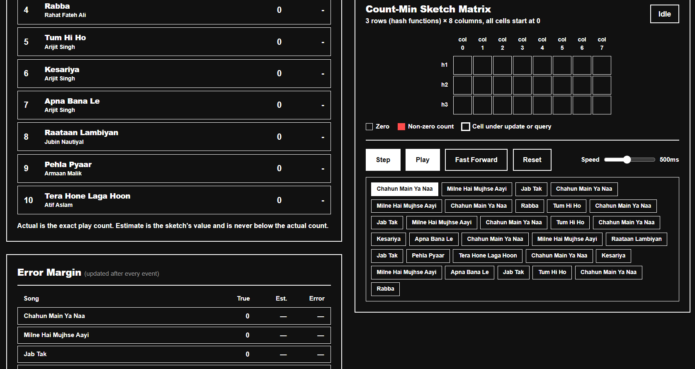

# Count-Min Sketch: A Probabilistic Data Structure

**When exact counting is too expensive, approximate with a guarantee.**

**A complete analysis, implementation, and interactive simulation of the Count-Min Sketch.**

## Overview

The **Count-Min Sketch (CMS)** is a probabilistic data structure used to estimate the frequencies of items in massive data streams. Instead of storing every distinct item (which requires \(O(N)\) memory), CMS uses a fixed-size matrix of counters and multiple hash functions to provide bounded-error estimates in \(O(1)\) memory relative to the stream size.

This repository contains:
1. A formal mathematical report on the structure and its \((\epsilon, \delta)\) guarantee.
2. The presentation in the repo is useful for understanding the project interactively.
3. An interactive, Spotify-themed web simulation to visualize how the sketch updates and queries data.

## Simulation

**[The live simulation](https://anmolsrw.onrender.com/projects/count-min-sketch)** 
*(Or view the local source in `/simulation/index.html`)*

The simulation models a music streaming service (like Spotify). It processes a stream of song plays, updates the sketch in real-time, and demonstrates:
- How collisions occur and inflate cell counts.
- Why we take the **minimum** across rows.
- How the empirical error margin stays below the theoretical bound \(\epsilon N\).

##  The Mathematics (TL;DR)

For any item x, with a matrix width w = **[e/epsilon]** and depth **(d = ln(1/delta)**:

 **[f(x) <= hat_f(x) <= f(x) + (epsilon*N) ]** 

with probability at least **\(1 - \delta\)**.

*Probability II Project, October 2026.*

## References
- Cormode, G., & Muthukrishnan, S. (2005). *An improved data stream summary: the count-min sketch and its applications.*
